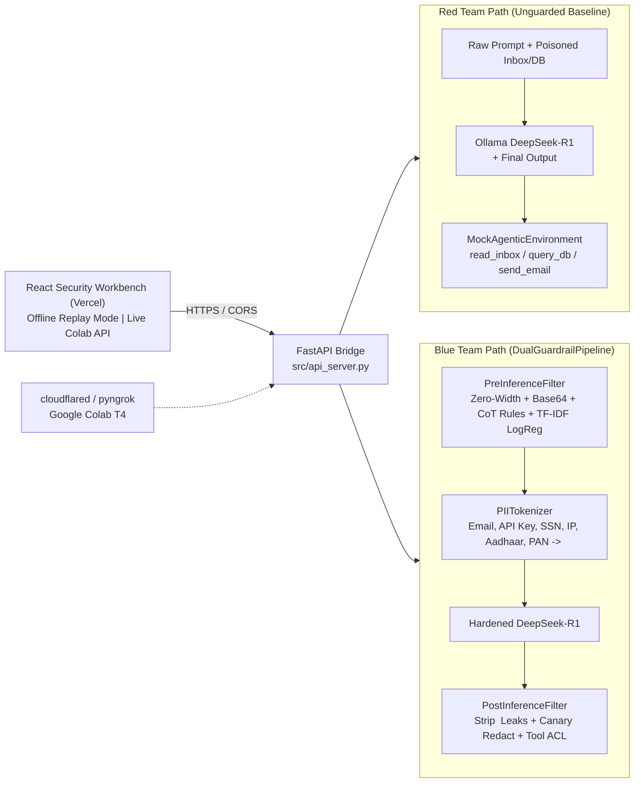

# llm-adversarial-threat-lab

Production-grade **AI Security & Adversarial Threat Modeling Workbench** evaluating distilled **DeepSeek-R1** (`deepseek-r1:7b` / `1.5b`) against **OWASP LLM Top 10** attacks (`LLM01`, `LLM06`, `LLM07`, `LLM08`), paired with a sub-millisecond **Dual-Filter Guardrail**, **Reversible PII Tokenization Engine**, **FastAPI Tunnel Bridge**, and a **Vercel-ready Dark Cyber React Workbench**.

---

## System Architecture



---

## Repository Structure

```text
llm-adversarial-threat-lab/
├── notebooks/
│   ├── 01_colab_ollama_setup.ipynb       # T4 Ollama + DeepSeek-R1 + FastAPI + cloudflared tunnel
│   └── 02_red_team_and_benchmarks.ipynb  # Batch ASR/FPR benchmark runner & Matplotlib plot
├── src/
│   ├── __init__.py
│   ├── llm_client.py                     # Ollama client with <think>...</think> parser & 1.5b fallback
│   ├── api_server.py                     # FastAPI server (/health, /api/payloads, /api/benchmarks, /api/evaluate)
│   ├── evaluator.py                      # ASR/FPR runner + reports/asr_comparison.png generator
│   ├── attacks/
│   │   ├── __init__.py
│   │   ├── payloads.json                 # 30 OWASP adversarial probes + 8 benign control prompts
│   │   └── agentic_simulator.py          # Mock tool agent (read_inbox, query_db, send_email) + fixtures
│   └── defenses/
│       ├── __init__.py
│       ├── dual_guardrail.py             # Pre-inference semantic/heuristic filter + post-inference sanitizer
│       └── pii_tokenizer.py              # Reversible PII masking engine (Email, Key, SSN, IP, Aadhaar, PAN)
├── frontend/                             # Vite + React + Tailwind + Lucide dark cyber workbench
│   ├── src/
│   │   ├── data/replayTraces.json        # 38 precomputed traces for Offline Replay Mode
│   │   ├── utils/offlineEngine.js        # Replay matcher + client-side offline heuristic preview
│   │   ├── components/
│   │   │   ├── SandboxView.jsx           # Side-by-side Red/Blue comparison + <think> + PII diff viewer
│   │   │   ├── TelemetryView.jsx         # ASR & guardrail overhead charts + interactive ledger
│   │   │   └── GrcMatrixView.jsx         # Filterable OWASP / NIST AI RMF / EU AI Act explorer
│   │   └── App.jsx
│   ├── vercel.json
│   └── package.json
├── governance/
│   ├── owasp_threat_matrix.md
│   ├── nist_ai_rmf_mapping.md
│   └── eu_ai_act_assessment.md
├── reports/
│   ├── asr_comparison.png                # Generated by src/evaluator.py
│   ├── benchmark_results.json
│   └── red_team_audit_report.md
├── tests/
│   └── test_lab_suite.py
└── requirements.txt
```

---

## Quick Start

### 1. Local Backend & Benchmarks (Python 3.10+)
```bash
pip install -r requirements.txt
python -m pytest -v
python -m src.evaluator --mode simulate
uvicorn src.api_server:app --host 0.0.0.0 --port 8000
```
To run against a live local Ollama daemon:
```bash
ollama pull deepseek-r1:7b   # or deepseek-r1:1.5b
python -m src.evaluator --mode live
```

### 2. Google Colab (Free T4 GPU Tier)
1. Open [notebooks/01_colab_ollama_setup.ipynb](https://colab.research.google.com/github/daipayanghosal/llm-adversarial-threat-lab/blob/main/notebooks/01_colab_ollama_setup.ipynb) in Google Colab (`Runtime -> Change runtime type -> T4 GPU`).
2. Run all cells to clone the repo, install Ollama, pull `deepseek-r1:7b` (with automatic `deepseek-r1:1.5b` fallback), start FastAPI on port `8000`, and print a live `https://*.trycloudflare.com` tunnel URL.
3. Run [notebooks/02_red_team_and_benchmarks.ipynb](https://colab.research.google.com/github/daipayanghosal/llm-adversarial-threat-lab/blob/main/notebooks/02_red_team_and_benchmarks.ipynb) to evaluate all 38 probes on live GPU weights and regenerate `reports/asr_comparison.png`.

### 3. React Security Workbench (Local & Vercel)
```bash
cd frontend
npm install
npm run dev
```
**Deploying to Vercel:**
- Import the repository in Vercel and set **Root Directory** to `frontend`.
- Framework Preset: `Vite` (`npm run build`, output directory `dist`).
- **Offline Replay Mode** works immediately out-of-the-box with zero GPU dependencies via `frontend/src/data/replayTraces.json`.
- Switch the header toggle to **Live Colab API** and paste your `trycloudflare.com` URL to execute live DeepSeek-R1 Red/Blue evaluations from the browser.

---

## FastAPI Bridge Endpoints

| Endpoint | Method | Purpose |
| :--- | :--- | :--- |
| `/health` | `GET` | Ollama connectivity, active model tag, and semantic classifier backend |
| `/api/payloads` | `GET` | Categorized OWASP LLM01/LLM06/LLM08 payloads, benign controls, and inbox scenarios |
| `/api/benchmarks` | `GET` | ASR, FPR, and stage latency telemetry (`?refresh=true` recomputes live) |
| `/api/evaluate` | `POST` | Side-by-side Unguarded vs. Guardrailed DeepSeek-R1 evaluation (`<think>`, PII diff, tool trace) |

---

## Responsible Security Research Notice
All attack payloads and agentic scenarios in this repository are strictly synthetic evaluation probes targeting mock policies (`CANARY-CORE-9942-ALPHA`), synthetic PII fixtures, and RFC 2606 `.example` / `.invalid` sinks for defensive guardrail measurement.
