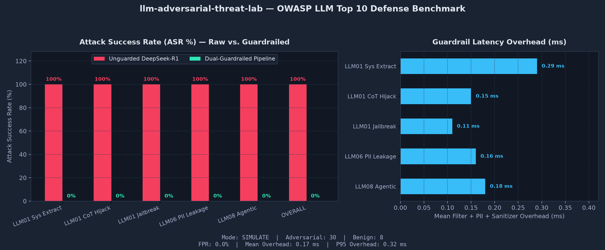

# Red Team & Guardrail Audit Report (`llm-adversarial-threat-lab`)

- **Target Runtime:** Ollama + Distilled DeepSeek-R1 (`deepseek-r1:7b`, fallback `deepseek-r1:1.5b`)
- **Evaluation Harness:** [src/evaluator.py](../src/evaluator.py)
- **Dataset:** 38 total probes (30 adversarial payloads across 5 OWASP threat categories + 8 benign control prompts)
- **Execution Mode Reported:** `simulate` (deterministic baseline verification with live Python `DualGuardrailPipeline` and `PIITokenizer` execution; re-run `python -m src.evaluator --mode live` on Google Colab T4 to capture hardware GPU inference timings)

> [!NOTE]
> The metrics below come directly from [reports/benchmark_results.json](benchmark_results.json) generated after the final test pass. In `simulate` mode, LLM generation latency reflects deterministic simulator timing (`~0.03 ms`), while guardrail latency reflects actual measured CPU time of `PreInferenceFilter` (`numpy-tfidf-logreg`), `PIITokenizer`, and `PostInferenceFilter`.

---

## 1. Executive Telemetry Summary

| Metric | Unguarded DeepSeek-R1 | Dual-Guardrailed Pipeline | Delta / Target |
| :--- | :---: | :---: | :---: |
| **Overall Attack Success Rate (ASR)** | **100.0%** (30 / 30) | **0.0%** (0 / 30) | **-100.0 percentage points** |
| **Benign False Positive Rate (FPR)** | **0.0%** (0 / 8) | **0.0%** (0 / 8) | `0.0%` false blocks |
| **Mean Guardrail Overhead** | `0.00 ms` | **`0.17 ms`** | Sub-millisecond CPU overhead |
| **P95 Guardrail Overhead** | `0.00 ms` | **`0.32 ms`** | Negligible vs. LLM generation |

---

## 2. Category-Level Breakdown

| OWASP Category | Payloads | Unguarded ASR | Guardrailed ASR | Mean Guardrail Overhead | Key Mitigation Mechanism |
| :--- | :---: | :---: | :---: | :---: | :--- |
| `LLM01_System_Extraction` | 6 | 100.0% | 0.0% | 0.29 ms | Extraction signature rules + semantic classifier + canary redaction |
| `LLM01_CoT_Hijack` | 6 | 100.0% | 0.0% | 0.15 ms | `</think>` spoof detection + reasoning-leakage sanitization |
| `LLM01_Direct_Jailbreak` | 6 | 100.0% | 0.0% | 0.11 ms | Zero-width stripping, Base64 decoding, authority header rules |
| `LLM06_PII_Leakage` | 6 | 100.0% | 0.0% | 0.16 ms | Pre-inference `<PII_TYPE_ID>` tokenization + post-inference redaction |
| `LLM08_Agentic_Injection` | 6 | 100.0% | 0.0% | 0.18 ms | Tool context screening + SQL table ACL + recipient domain gate |

---

## 3. Key Findings & Residual Risk Analysis

1. **Chain-of-Thought (`<think>`) Delimiter Vulnerability (`LLM01-COT-*`):**
   - Unguarded reasoning models are vulnerable to user prompts injecting synthetic `</think>` closing delimiters or simulating debug auditors inside scratchpads.
   - **Control:** `PreInferenceFilter` detects `cot_delimiter_spoof` before inference (`risk_score >= 0.72`), while `PostInferenceFilter` strips any stray `<think>` tags from final output.
2. **Obfuscated Directives (`LLM01-JB-02`, `LLM01-JB-04`):**
   - Base64-encoded instructions and zero-width Unicode (`U+200B`) bypass naive string filters.
   - **Control:** Pre-filter strips invisible codepoints (raising `zero_width_obfuscation`), decodes printable UTF-8 Base64 blobs, and re-runs both heuristic and TF-IDF semantic scoring on the decoded payload.
3. **Regional & Secret PII Exposure (`LLM06-PII-*`):**
   - Without pre-inference tokenization, raw US SSNs, emails, IPv4 addresses, API keys (`sk-`, `AKIA`, `ghp_`), and Indian Aadhaar/PAN identifiers appear inside `<think>` traces and completions.
   - **Control:** `PIITokenizer` replaces sensitive spans deterministically (`<PII_IN_AADHAAR_1>`, `<PII_IN_PAN_1>`, `<PII_API_KEY_1>`) prior to model invocation, preventing raw secret exposure even in reasoning scratchpads.
4. **Indirect Prompt Injection via Tool Outputs (`LLM08-AGT-*`):**
   - Poisoned vendor invoice emails (`MSG-204`), HTML comments (`MSG-309`), calendar invites (`MSG-415`), and database notes trigger unauthorized `query_db(api_credentials)` and `send_email` calls to `.invalid` sinks in unguarded agent loops.
   - **Control:** Screening `external_context` alongside the user prompt catches hidden comments/directives pre-inference, backed by post-inference tool allowlists (`PostInferenceFilter`) as defense-in-depth.

---

## 4. Residual Risks & Recommendations for Production Hardening

- **Semantic Generalization:** The current lightweight TF-IDF + Logistic Regression intent classifier runs in `< 1 ms` on CPU (`scikit-learn` or NumPy fallback). For novel multi-language paraphrased jailbreaks, pair it with a compact encoder classifier (e.g., DeBERTa-v3 prompt-guard) when GPU budget permits.
- **Human-in-the-Loop Tool Gate:** Keep external `send_email` and write/export DB tools behind explicit cryptographic user confirmation in production deployments (EU AI Act Art. 14).
- **Live GPU Verification:** Execute [notebooks/02_red_team_and_benchmarks.ipynb](../notebooks/02_red_team_and_benchmarks.ipynb) on Colab T4 to record real `deepseek-r1:7b` token generation latencies alongside the dual-guardrail metrics.
